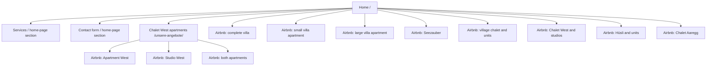

# Existing Website: vermieterservice.ch

Reviewed: November 3, 2026  
Primary source: [vermieterservice.ch](https://www.vermieterservice.ch/)

## Visual sitemap

## Global elements

| Area | Current implementation |
| --- | --- |
| Brand | House icon and “Vermieter Service Hürzeler GmbH” |
| Navigation | “Angebot” links to the home page; “Chalet West apartments Brienz” opens the second page |
| Contact | Email address, telephone number, and business address |
| Language | Home page is mostly German; Chalet West page is English |
| External destinations | 16 Airbnb links from the home page and additional Airbnb links from the Chalet West page |
| Technology | Sitebuilder pages, static content, and an external contact-form endpoint |

## Page 1: Home `/`

### Purpose

Acquire property-owner clients for holiday-rental management or long-term tenant searches while also presenting the managed holiday properties.

### Content inventory

1. **Hero and value proposition**
   - Rent a property to holiday guests or long-term tenants
   - Local full-service management in Brienz
2. **Six holiday-rental services**
   - Bookings and professionally prepared listings
   - Personal guest support in five languages
   - In-house cleaning team and same-day turnovers
   - Interior-design guidance
   - Maintenance and repair coordination
   - Pricing strategy and monthly statements
3. **Long-term tenant search**
   - Define the desired tenant profile
   - Listing, forms, contracts, and credit checks
   - Preselection of suitable applicants
   - Transparent fixed prices
4. **About Vermieter Service**
   - Choice between holiday and long-term rental
   - Team of up to ten people
   - Positioning based on reliability, organization, and personal care
5. **Accommodation catalog**
   - Complete villa, small villa apartment, and large villa apartment
   - Seezauber by the lake
   - Complete village chalet, studio, 2.5-room apartment, and 3.5-room apartment
   - Chalet West combination, large apartment, Studio West, and Studio East
   - Complete Hüsli, upper apartment, and ground-floor apartment
   - Chalet Aaregg
6. **Contact and consultation**
   - Name, email, and message fields
   - Value proposition: rental income without handling day-to-day guest support
   - Transparent pricing without hidden fees

### Functionality inventory

| Function | Current behavior |
| --- | --- |
| Navigation | Two main links; no deeper information hierarchy |
| Accommodation calls to action | Open external Airbnb listings |
| Contact form | Name, email, and message; submission through an external form service |
| Responsive layout | Provided by the sitebuilder |
| Search and filters | Not available |
| Local accommodation detail pages | Not available |
| Language selection | Not available |

## Page 2: Chalet West `/unsere-angebote/`

### Purpose

English-language details and booking overview for Chalet West.

### Content inventory

- Apartment West for 8–10 people and three babies
- Studio West for two people and one baby
- Both apartments together for 10–12 people
- An additional Studio East available on request
- Free parking
- Style, comfort, and lake and mountain views
- Floor-by-floor description:
  - entrance-level studio with bed, bathroom, and small kitchen
  - first floor with living room, kitchen, balcony, terrace, gas grill, and guest WC
  - second floor with three bedrooms, large bathroom, balcony, and workspaces
  - third floor with bedroom, balcony, workspace, and bathroom
- Bidet toilets, blackout options, mosquito nets, and fans
- Complimentary baby equipment on request

### Functionality inventory

| Function | Current behavior |
| --- | --- |
| Booking links | Three external Airbnb links |
| Navigation | Returns to the main page or reloads the current page |
| Contact | Telephone and email in the footer |
| Interactive gallery | Not available |
| Inquiry form | Not available |

## Key issues and opportunities

- Property owners and holiday guests share one long page without a clear audience split.
- The 16 accommodations have no local detail pages, sending visitors directly to Airbnb.
- The Chalet West page breaks the German-language experience.
- There is no language switcher, accommodation search, filtering, availability inquiry, or local outing guide.
- Valuable facts are available, but information hierarchy, readability, and cross-linking are weak.
- The redesign should establish equivalent German and English journeys rather than mixing languages within individual pages.

