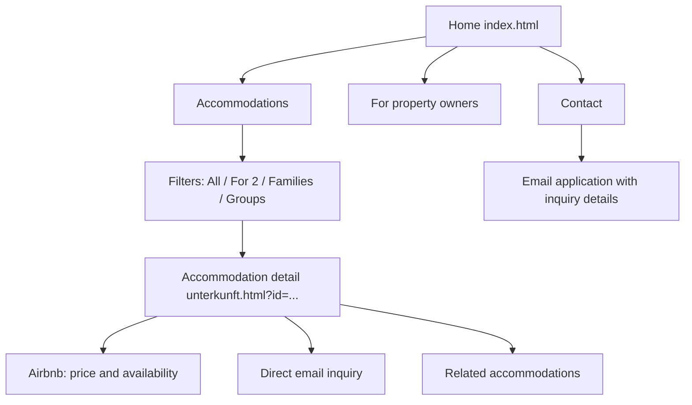

# Current Prototype in This Repository

Reviewed: November 3, 2026  
Source: `/Users/aoesterer/code/vermieterservice`

## Visual sitemap

## Global architecture

| File | Responsibility |
| --- | --- |
| `index.html` | Home page and all marketing sections |
| `unterkunft.html` | Shared accommodation-detail template |
| `src/data.js` | 16 structured accommodation records |
| `src/main.js` | Card rendering, filters, and mobile navigation |
| `src/detail.js` | Detail rendering, Airbnb/email actions, and recommendations |
| `src/style.css` | Complete responsive visual system |
| `assets/images/` | Hero and accommodation photography |
| `.nojekyll` | Direct GitHub Pages publishing support |

The site is buildless: it uses classic JavaScript, relative paths, and no npm dependency.

## Page 1: Home `index.html`

### Content inventory

1. **Navigation:** Accommodations, For Property Owners, Contact, and telephone number
2. **Hero:** Brienz landscape, “Arrive. Breathe. Feel at home.” concept, and two audience calls to action
3. **Introduction:** Positioning as a personally managed accommodation collection in Brienz
4. **Accommodation catalog:** dynamically generated cards for all 16 offers
5. **Owner services:** listings/bookings, guest care, cleaning/maintenance
6. **Trust points:** five languages, local team, transparent costs
7. **Contact:** name, email, area of interest, and message
8. **Footer:** company, telephone, email, and address

### Functionality inventory

| Function | Implementation |
| --- | --- |
| Accommodation filters | All, for two people, families, and groups |
| Cards | Generated from `window.listings`; open the relevant detail view |
| Mobile menu | Expandable navigation |
| Contact form | Opens the visitor’s email application through `mailto:` |
| Responsive design | Desktop, tablet, and mobile layouts |
| Languages | German only in the current prototype; English is not implemented yet |

## Page 2: Accommodation template `unterkunft.html?id={id}`

### Content inventory per accommodation

- Large hero image, category, title, and short promise
- Editorial description
- Six amenity highlights
- “Between lake and mountains” location section
- Guest capacity, accommodation size, and baby capacity
- Airbnb link for pricing and availability
- Direct email inquiry
- Up to three related accommodations from the same audience category

### Functionality inventory

| Function | Implementation |
| --- | --- |
| Dynamic selection | The `id` URL parameter selects a record |
| Fallback | An unknown ID displays the first accommodation |
| External booking | Opens Airbnb in a new window |
| Direct inquiry | Opens an email with a prefilled subject line |
| Recommendations | Automatically selects accommodations in the same category |

## Inventory of the 16 detail views

| ID / URL parameter | Prototype title | Audience | Capacity | External booking |
| --- | --- | --- | ---: | --- |
| `villa-gesamt` | Die Villa – beide Wohnungen | Groups | 12 | Airbnb |
| `villa-apartment` | Gemütliche Wohnung in der Villa | Families | 4 | Airbnb |
| `villa-gross` | Grosse Wohnung in der Villa | Groups | 8 | Airbnb |
| `seezauber` | Seezauber – Wohnung am See | Families | 7 | Airbnb |
| `dorf-chalet` | Ganzes Chalet im Dorfkern | Groups | 15 | Airbnb |
| `dorf-studio` | Studio im Dorfchalet | For 2 | 2 | Airbnb |
| `dorf-mitte` | Wohnung im Dorfchalet | Families | 5 | Airbnb |
| `dorf-oben` | Maisonette im Dorfchalet | Groups | 8 | Airbnb |
| `chalet-west-beide` | Chalet West – beide Wohnungen | Groups | 10 | Airbnb |
| `chalet-west` | Grosses Apartment Chalet West | Groups | 8 | Airbnb |
| `chalet-west-studio` | Studio Chalet West | For 2 | 2 | Airbnb |
| `chalet-ost-studio` | Studio Chalet Ost | For 2 | 2 | Airbnb |
| `huesli-gesamt` | Ganzes Chalet Hüsli | Groups | 6 | Airbnb |
| `huesli-oben` | Wohnung im Hüsli oben | For 2 | 2 | Airbnb |
| `huesli-unten` | Wohnung im Hüsli unten | Families | 4 | Airbnb |
| `chalet-aaregg` | Chalet Aaregg direkt am See | Groups | 8 | Airbnb |

Original German titles are retained above because they are current source-data values rather than design-document language.

## Missing or incomplete areas

- No English version or language switcher
- No outing or destination-guide structure
- No translated or adapted Brienz Villa travel guidance
- No true static URL per accommodation; details currently use query parameters
- No server-side form delivery or availability integration
- No privacy policy or legal-notice page
- No XML sitemap or structured accommodation data

## Bilingual requirements for the next iteration

- German and English must be complete, equivalent experiences.
- Language selection must persist between pages.
- Every accommodation and outing needs both language versions before publication.
- Metadata, navigation, forms, validation, email templates, and accessibility labels must also be translated.
- URLs should use an explicit, consistent language strategy such as `/de/…` and `/en/…`.

