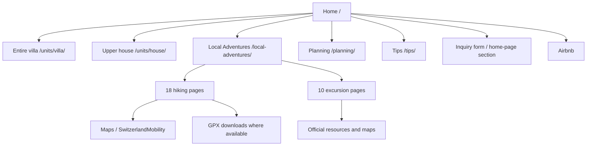

# Brienz Villa Website and Content Inventory

Reviewed: November 3, 2026  
Sources: [brienzvilla.com](https://brienzvilla.com/) and `/Users/aoesterer/code/brienzvilla`

## Visual sitemap

## Global elements

| Area | Current implementation |
| --- | --- |
| Language | English |
| Navigation | The villa, Ways to stay, Local Adventures, Tips, Inquire |
| Brand | “Brienz Villa,” lake and Alpine photography, calm premium tone |
| Contact | `info@brienzvilla.com`, inquiry form, and Airbnb |
| Technology | Static GitHub Pages site with data-driven cards and detail pages |
| Analytics | Google Tag Manager |
| SEO | XML sitemap, canonical URLs, and individual meta descriptions |

## Primary pages

### 1. Home `/`

**Content**

- “Find serenity in Brienz” hero
- Key facts: 12 guests and five bedrooms
- 47-image villa gallery
- Offer cards for the entire villa and upper house
- Selected Airbnb guest reviews
- YouTube video tour
- Embedded outing catalog
- Stay inquiry form with dates, adults, children, and message

**Functionality**

- Previous/next gallery navigation and full-screen dialog
- Dynamic outing search, six filters, and three sorting options
- Outing detail dialog
- Inquiry form that prepares a prefilled email
- Airbnb availability and external video playback

### 2. Local Adventures `/local-adventures/`

**Content**

- Complete catalog of 28 hikes and excursions
- Comparison table for all hikes
- Distance, duration, ascent, difficulty, and season data

**Functionality**

- Full-text search
- Filters: all, hikes, excursions, family, by the water, and strenuous
- Sorting: recommendations, easiest first, and shortest first
- Sortable comparison table
- Links to 28 standalone detail pages

### 3. Planning `/planning/`

**Content**

- Ideas for enjoying Brienz itself
- Easy local days
- Mountain days
- Flexible day trips
- Additional planning ideas
- Weather, reservations, and Brienz Experience Card guidance
- Advice for traveling with children

**Functionality**

- Editorial planning guide
- Cross-link to the complete outing catalog
- No search or form interactions

### 4. Tips `/tips/`

**Content**

- Quick index with four topic groups
- Car versus train, arrivals, taxis, and rail passes
- Grocery shopping, bakeries, and Sunday options
- Raclette, fondue, and Swiss sausage guidance
- Useful apps: SwitzerlandMobility, MeteoSwiss, SBB, EasyPark, and PayByPhone

**Functionality**

- In-page anchor navigation
- External map, rail-pass, and app links
- Editorial image galleries for Swiss meals

### 5. Entire Villa `/units/villa/`

**Content**

- 12 guests, five bedrooms, two kitchens, and two private units
- Complete house description and room-by-room tour
- Three full bathrooms plus guest WC, terrace, fireplace, grill, and kayak
- Parking for four cars, no pets, quiet hours, and no smoking
- Arrival and shopping guidance
- Detailed amenities in six categories

**Functionality**

- Interactive house tour/gallery
- Inquiry action and Airbnb calendar
- Cross-links to the upper house and Local Adventures

### 6. Upper House `/units/house/`

**Content**

- Eight guests, four bedrooms, kitchen, and lake-view terrace
- Description of the private main floors
- Two-and-a-half bathrooms, grill, kayak, and shared laundry
- Notes about the separately rented lower apartment
- Arrival and amenity information

**Functionality**

- Interactive house tour/gallery
- Inquiry action and Airbnb calendar
- Cross-link to the entire villa

## Shared outing-page models

### Hiking pages

Each hiking page contains a title, season or kicker, summary, six statistics, photo gallery, travel and route instructions, static or external map, and—where available—a GPX download. The pages share presentation and JavaScript while loading their individual content from a local `data.js` file.

### Excursion pages

Each excursion page contains a title, kicker, editorial description, photo gallery, travel guidance, and links to official resources or maps. These pages also use a shared template with an individual `data.js` file.

## Complete inventory of 28 outing detail pages

| Page / slug | Type | Content focus | Tags and functionality |
| --- | --- | --- | --- |
| `schynige-platte` | Hike | Panoramic loop reached by cogwheel railway | Family; map; route; gallery |
| `eigergletscher-to-wengen` | Hike | Descent from Eigergletscher to Wengen | Strenuous; map; gallery |
| `first-to-bachalpsee` | Hike | First to Bachalpsee | Family; mountain lake; map |
| `axalp-wooden-statue-loop` | Hike | Woodcarving trail on Axalp | Family; local; gallery |
| `axalp-giant-swing` | Hike | Giant swing on Axalp | Family; local; gallery |
| `bramisegg-to-axalp` | Hike | Bramisegg to Axalp route | Local; map; route data |
| `brienz-rothorn` | Hike | Brienz to Brienzer Rothorn | Strenuous; local; elevation data |
| `brienz-rothorn-to-brunig-pass` | Hike | Rothorn to Brünig Pass | Strenuous; long route |
| `eigergletscher-to-alpiglen` | Hike | Eigergletscher to Alpiglen | Strenuous; Eiger scenery |
| `giessbach-falls-to-iseltwald` | Hike | Lakeside route from Giessbach to Iseltwald | Family; water; local |
| `grosse-scheidegg-to-first` | Hike | Grosse Scheidegg to First | Family; panoramic route |
| `grutschalp-allmendhubel-murren` | Hike | Grütschalp, Allmendhubel, and Mürren | Family; mountain transport |
| `harder-kulm-loop` | Hike | Harder Kulm loop | Strenuous; Interlaken |
| `mannlichen-to-kleine-scheidegg` | Hike | Männlichen to Kleine Scheidegg | Family; panoramic trail |
| `murren-allmendhubel-loop` | Hike | Mürren and Allmendhubel loop | Family; mountain village |
| `brienz-to-planalp` | Hike | Brienz to Planalp | Strenuous; local |
| `rosenlaui-to-grosse-scheidegg` | Hike | Rosenlaui to Grosse Scheidegg | Mountain route; map |
| `schrattenflue-hangst` | Hike | Schrattenfluh/Hängst | Strenuous; karst landscape |
| `aare-gorge-reichenbach-falls` | Excursion | Aare Gorge and Reichenbach Falls | Family; water; external resources |
| `ballenberg-open-air-museum` | Excursion | Open-air museum, crafts, and animals | Family; local; rainy-day option |
| `bern-day-trip` | Excursion | Bern day trip | Family; city |
| `gruyeres-day-trip` | Excursion | Gruyères day trip | Family; village and food |
| `interlaken-day-trip` | Excursion | Interlaken day trip | Family; near Brienz |
| `jungfraujoch-top-of-europe` | Excursion | Jungfraujoch | Family; high-Alpine railway |
| `lake-brienz-by-boat` | Excursion | Lake Brienz by boat | Family; water; local |
| `lucerne-day-trip` | Excursion | Lucerne day trip | Family; city and lake |
| `brienz-rothorn-railway` | Excursion | Brienz Rothorn Railway | Family; local; mountain railway |
| `activities-for-kids` | Excursion | Collection of child-friendly activities | Family; local; collection page |

## Reusable content and data sources in the repository

| Path | Reusable material |
| --- | --- |
| `outings.js` | Base catalog and card data |
| `outings/imported-hikes.js` | 16 additional hiking cards |
| `outings/imported-excursions.js` | 10 excursion cards |
| `outings/{slug}/data.js` | Full text, images, routes, resources, and metadata |
| `assets/images/outings/{slug}/` | Outing photos and some maps/GPX files |
| `local-adventures/` | Search, filters, sorting, and comparison table |
| `planning/` | Curated travel-planning content |
| `tips/` | Practical travel and Switzerland guidance |

## Reuse value for Vermieter Service

- **Very high:** 28 outing records, images, categories, search/filter behavior, and detail-page model
- **High:** travel planning, public-transport/car advice, local shopping tips, and useful apps
- **Selective:** villa-specific guidance such as walking times, equipment, kayak, or raclette oven
- **Do not copy directly:** Brienz Villa booking calls to action, property-specific claims, or owner-specific voice

## Language implications

- Brienz Villa provides an English editorial source that can inform the English Vermieter Service version.
- A native-quality German adaptation is required for every reused outing; automatic runtime translation is not recommended.
- Both language versions should share facts, images, taxonomy, and update dates while allowing language-specific editorial phrasing.

