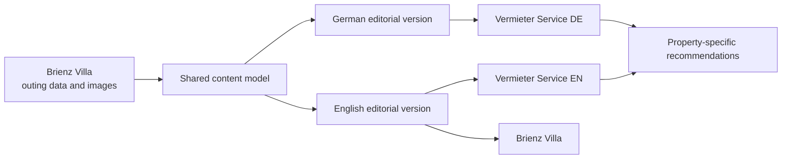
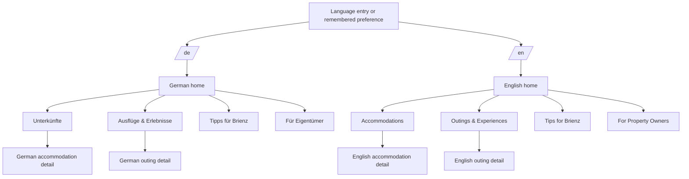

# Brienz Villa Content Reuse Plan

## Target outcome

Vermieter Service will offer a bilingual German-and-English destination guide for guests staying at any managed property. Brienz Villa remains an editorial source; the content is adapted to the Vermieter Service brand, audience, and accommodation portfolio.

## Recommended bilingual site structure

Every German page should have a direct English counterpart, and the language switcher should preserve the visitor’s current content context whenever possible.

## Shared content model

Each outing should contain at least the following fields:

| Field | Purpose |
| --- | --- |
| `slug` | Stable identifier shared across languages |
| `title.de` / `title.en` | Localized titles |
| `summary.de` / `summary.en` | Localized card copy |
| `body.de` / `body.en` | Localized full editorial content |
| `type` | Hike or excursion |
| `tags` | Family, water, local, strenuous, and similar attributes |
| `season` | Recommended months; language-neutral source value where possible |
| `duration`, `distance`, `ascent` | Shared comparison values |
| `directions.de` / `directions.en` | Localized travel and route instructions |
| `resources` | Official external links |
| `images` | Shared image references with localized alt text |
| `source` | Origin, usage rights, and last review date |
| `translationStatus` | Draft, reviewed, or published for each language |

## Migration priorities

### Phase 1: broad local recommendations

1. Lake Brienz by boat
2. Brienz Rothorn Railway
3. Ballenberg Open-Air Museum
4. Giessbach Falls to Iseltwald
5. Activities for children
6. Axalp woodcarving trail and giant swing

These subjects suit most guests, are close to Brienz, and reinforce Vermieter Service’s local positioning.

### Phase 2: well-known day trips

- Interlaken
- Jungfraujoch
- Aare Gorge and Reichenbach Falls
- Lucerne, Bern, and Gruyères
- Family-friendly panoramic trails

### Phase 3: strenuous hikes

- Brienz to Rothorn, Rothorn to Brünig Pass, and Brienz to Planalp
- Eigergletscher routes
- Harder Kulm and Schrattenfluh

Conditions, season, links, and safety guidance should be checked before publication in either language.

## Technical recommendation

1. Do not copy the outing content into two independently maintained datasets.
2. Store shared facts and localized fields in one neutral JSON or JavaScript content model.
3. Generate or render both websites from the same source records.
4. Maintain German and English as explicit editorial fields; do not translate content in the visitor’s browser.
5. Keep original images in one controlled source and produce optimized derivatives for each website.
6. Give every language version its own canonical URL and connect counterparts with `hreflang` metadata.
7. Use `/de/…` and `/en/…` paths for a clear, scalable URL model.
8. Store the preferred language locally and preserve it across navigation.

## Editorial rules

- Project communication and design documentation remain in English.
- German and English public content must be reviewed as independent, natural-language copy.
- Do not use “tested by our family” on Vermieter Service unless that statement is accurate for the business; use neutral wording such as “Our recommendation” instead.
- Remove villa-specific walking times and equipment references or associate them with the correct property only.
- Mark prices, opening hours, timetables, and seasonal conditions as changeable.
- Record source attribution and image rights for each outing.
- Review safety-related hiking information before every season.
- Translate metadata, form labels, validation messages, accessibility labels, and prepared emails—not only visible body copy.

## Connecting outings to accommodations

Outings can be recommended automatically using shared tags:

| Accommodation attribute | Recommended outing attributes |
| --- | --- |
| Families or babies | Family, local, shorter duration |
| Directly by the lake | Water and local |
| Groups | Simple logistics and clear reservation guidance |
| Pets | Dog-friendly only when verified |
| Hiking-focused stays | Hikes sorted by difficulty |
| Car-free stays | Easily accessible by public transport |

## Language workflow

1. Finalize shared factual content first.
2. Prepare the English editorial source using the Brienz Villa material.
3. Create a natural German adaptation rather than a literal translation.
4. Have both versions reviewed for local terminology, safety, and tone.
5. Publish a page only when both language states are marked reviewed, unless an explicit phased launch is approved.
6. When facts change, update the shared values once and review any affected localized paragraphs.

## Next implementation steps

1. Confirm content and image rights for the 28 existing articles.
2. Define the shared bilingual schema and URL convention.
3. Prepare German and English versions of the six Phase 1 subjects.
4. Add a persistent language switcher to the Vermieter Service prototype.
5. Add a bilingual catalog page with search, filters, and sorting.
6. Create one static, indexable detail page per outing and language.
7. Add three contextually relevant outing recommendations to each accommodation page.
8. Update XML sitemaps, canonical URLs, `hreflang`, structured data, and internal links.

